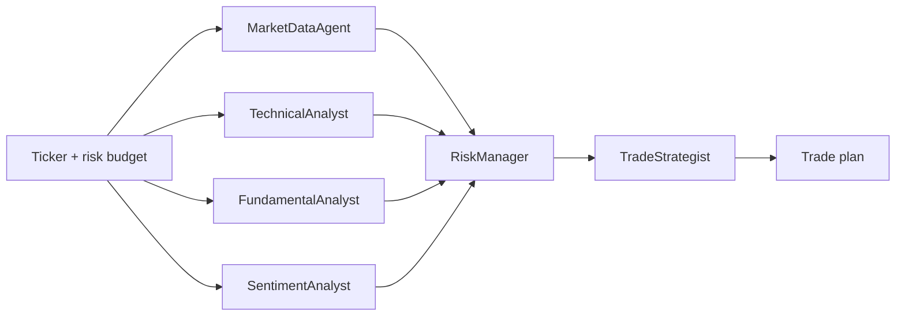

# Multi-Agent Stock Analysis & Trading Research

A six-agent research crew built on the **Microsoft Agent Framework** (Python), using
**OpenAI** and **Anthropic** models side by side against live market data.

> Research tooling only. Not investment advice.

## Two separate systems in this repo

- **`src/stock_agents/`** — the LLM research crew below. Non-deterministic by
  nature (same prompt can take a different tool-call path on different runs),
  so it is for overnight research, not for the order-placement path.
- **`src/stock_agents/kite/`** — a deterministic intraday runner against Kite
  Connect, with no LLM anywhere in it. See [Intraday runner (Kite Connect)](#intraday-runner-kite-connect).

## The crew

| Agent | Provider | Role |
|---|---|---|
| `MarketDataAgent` | OpenAI | Quotes, returns, volatility, drawdown, peer comparison |
| `TechnicalAnalyst` | OpenAI | SMA/EMA, RSI, MACD, Bollinger, support & resistance |
| `FundamentalAnalyst` | Anthropic\* | Valuation, margins, growth, leverage, analyst targets |
| `SentimentAnalyst` | Anthropic\* | News flow and sell-side positioning |
| `RiskManager` | Anthropic\* | Devil's advocate, stop-loss and position sizing |
| `TradeStrategist` | OpenAI | Synthesises everything into one trade plan |

\* These three fall back to the OpenAI/Azure client when `ANTHROPIC_API_KEY` is
empty, so the crew runs on a single provider until you add an Anthropic key.

The quantitative roles run on OpenAI, the judgement-heavy roles on Anthropic, so
the final recommendation reflects two independent model families.

## Orchestration



The four analysts run **concurrently**, fan in to the risk manager, and the
strategist produces the final plan.

## Setup

```bash
pip install -r requirements.txt
cp .env.example .env     # then add your real keys
```

### OpenAI platform

```
OPENAI_API_KEY=sk-...
OPENAI_BASE_URL=
OPENAI_CHAT_MODEL_ID=gpt-4.1
```

### Azure AI Foundry

Azure resource keys are not `sk-...` keys and are rejected by `api.openai.com`.
Point `OPENAI_BASE_URL` at the OpenAI-compatible **v1** endpoint instead — no
`api_version` needed — and set the model to your **deployment name**:

```
OPENAI_API_KEY=<azure-resource-key>
OPENAI_BASE_URL=https://<resource>.services.ai.azure.com/openai/v1
OPENAI_CHAT_MODEL_ID=<deployment-name>
```

### Anthropic (optional)

```
ANTHROPIC_API_KEY=sk-ant-...
ANTHROPIC_MODEL_ID=claude-sonnet-4-5-20250929
```

Leave it empty and all six agents use the OpenAI/Azure client.

## Usage

```bash
# Single ticker
python main.py AAPL

# Several tickers, custom risk parameters
python main.py AAPL MSFT NVDA --equity 250000 --risk 1.5 --horizon "6-12 months"

# Print every agent's report, not just the final plan
python main.py TSLA --full
```

Markdown reports are written to `reports/<SYMBOL>.md`.

## Running a subset of agents

`--agents` takes a comma-separated list, so you can iterate on one agent without
paying for the other five:

```bash
python main.py TCS.NS --agents sentiment                 # ~4.7k tokens
python main.py TCS.NS --agents technical,fundamental
python main.py TCS.NS --agents sentiment,strategist      # ~10.5k tokens
```

Valid names: `market_data`, `technical`, `fundamental`, `sentiment`, `risk`,
`strategist`. Order doesn't matter — the pipeline order is always preserved.

The fan-in agents degrade rather than fail: run `strategist` without its upstream
agents and it is told plainly that no analyst or risk reports were produced,
instead of being handed an empty prompt.

## Token usage

Every run prints a per-agent token breakdown and appends it to the report:

```
Agent                      input    output  reasoning     total
Market Data                8,077     3,258      2,496    11,335
Technical Analysis         3,424     4,331      2,432     7,755
Fundamental Analysis       2,182     4,772      3,328     6,954
Sentiment Analysis         1,577     2,841      1,408     4,418
Risk Assessment           13,568     4,563      2,752    18,131
Trade Plan                 6,778     3,833      2,432    10,611
TOTAL                     35,606    23,598     14,848    59,204
```

Two things to note when reading it:

- **Reasoning tokens are billed at output rates but never appear in the text.** On
  `gpt-5` they ran ~63% of all output tokens, so ignoring them badly understates cost.
- **Input dominates for the fan-in agents.** RiskManager and TradeStrategist receive
  every upstream report, so their prompts are large. Trimming analyst verbosity cuts
  cost roughly three times over.

## Non-US markets

Use the Yahoo suffix for the exchange. Currency is detected automatically and
every agent is told to quote prices in it — `--equity` is interpreted in that
same currency, and no FX conversion is applied anywhere.

```bash
python main.py RELIANCE.NS TCS.NS --equity 1000000 --risk 1.5   # ₹10L, INR
python main.py VOD.L --equity 50000                              # GBP
python main.py 7203.T                                            # JPY
```

| Market | Suffix | Example |
|---|---|---|
| India — NSE | `.NS` | `RELIANCE.NS`, `TCS.NS`, `INFY.NS` |
| India — indices | — | `^NSEI` (Nifty 50), `^BSESN` (Sensex) |
| London | `.L` | `VOD.L` |
| Tokyo | `.T` | `7203.T` |

Override detection with `--currency INR` if a ticker resolves wrongly.

### India caveats

- **Use `.NS`, not `.BO`.** Yahoo returns only a single bar of history for BSE
  tickers, so no indicator can be computed. The tools now raise a clear error
  rather than silently returning empty indicators.
- Fundamentals are mostly populated for large caps, but fields like `returnOnEquity`,
  `freeCashflow` and the liquidity ratios are often missing. These appear in an
  `unavailable_fields` list and agents are instructed to exclude them from their
  conclusions rather than estimating around them.
- Analyst coverage and price targets *are* available for NSE tickers.
- Not modelled: F&O lot sizes, daily circuit/price bands, STT and stamp duty.
  The RiskManager is prompted to mention them, but position sizing returns plain
  share counts.
- In India, investment advice is a SEBI-regulated activity. This is personal
  research tooling — do not distribute its output as advice.

### As a library

```python
import asyncio
from stock_agents import analyze_symbol

result = asyncio.run(analyze_symbol("NVDA", account_equity=50_000, risk_per_trade_pct=2.0))
print(result.final_plan)
print(result.reports["risk"])
```

## Layout

```
main.py                        CLI entry point
src/stock_agents/config.py     Env loading + OpenAI / Anthropic client factories
src/stock_agents/tools.py      yfinance-backed @tool functions
src/stock_agents/agents.py     The six agent definitions
src/stock_agents/orchestrator.py  Fan-out / fan-in pipeline
```

## Tools available to the agents

`get_quote`, `get_price_history`, `get_technical_indicators`, `get_fundamentals`,
`get_analyst_view`, `get_recent_news`, `get_corporate_announcements`,
`compare_symbols`, `size_position`.

All are plain Python functions decorated with `@tool`; the framework derives the
JSON schema from the type annotations, so adding a new tool is just writing a
function and appending it to the relevant list in `tools.py`.

## Notes

- Market data comes from Yahoo Finance via `yfinance` — delayed, best-effort, and
  occasionally incomplete. Tools report `unavailable_fields`, `unavailable_indicators`
  and `bars_available` so the agents can see the gaps instead of reasoning around them.
- **News falls back to Google News RSS.** Yahoo returns zero headlines for Indian
  tickers (verified on TCS.NS, RELIANCE.NS, INFY.NS); Google News India returns dated
  coverage from Livemint, Business Standard, BusinessLine and similar. `get_recent_news`
  reports which `source` it used and a `headline_count`.
- **NSE corporate announcements** (`get_corporate_announcements`) give the SentimentAnalyst
  primary-source filings for `.NS` tickers — RHPs, allotments, credit ratings, board
  meetings, trading-window closures. More authoritative than press coverage, and it
  surfaces scheduled events the news feed misses. Returns `supported: false` for
  non-NSE tickers rather than failing.
- Attachment PDFs are linked but not parsed, so filing *detail* beyond the summary
  text is unavailable; agents are told to say so rather than infer it.
- The SentimentAnalyst must cite a headline and date for every narrative claim. With
  `headline_count: 0` it is instructed to say so and cap confidence at 30, rather than
  filling the gap with sector commentary from model knowledge.
- Agent failures in the parallel phase are captured per-agent so one bad provider
  call does not abort the whole run.
- `--out` controls the report folder; it is gitignored by default.

## Intraday runner (Kite Connect)

`src/stock_agents/kite/` is a **separate, deterministic** system for intraday
trading. It has no dependency on `agent_framework` and no LLM anywhere in its
path — signal generation, sizing, and order placement must be identical given
the same inputs, which an LLM cannot guarantee. Use the research crew above for
overnight preparation; use this for execution.

```
src/stock_agents/kite/client.py    Kite Connect wrapper: candles, quotes, orders
src/stock_agents/kite/strategy.py  Pure-pandas signal rules (ORB + relative volume)
src/stock_agents/kite/risk.py      Daily loss cap, trade-count cap, risk-based sizing
src/stock_agents/kite/backtest.py  Walk-forward replay of strategy.py against history
src/stock_agents/kite/runner.py    CLI: scan, backtest, square-off
src/stock_agents/kite/login.py     Daily access-token refresh (manual browser login)
```

### Setup

```bash
pip install -r requirements.txt   # includes kiteconnect
```

Add to `.env`:

```
KITE_API_KEY=...
KITE_API_SECRET=...
KITE_ACCESS_TOKEN=          # leave empty until you run login.py
```

Kite's access token expires every trading day and requires a real browser
login — this is **not automated**, on purpose. Run this each morning before
trading:

```bash
PYTHONPATH=src python -m stock_agents.kite.login
```

### Usage

```bash
# Dry run - prints signals and sizing, places nothing (the default)
PYTHONPATH=src python -m stock_agents.kite.runner scan TCS RELIANCE HDFCBANK \
    --equity 200000 --risk 0.5 --max-daily-loss 2.0 --max-trades 5

# Live - actually places the entry order plus an exchange-side SL-M stop
PYTHONPATH=src python -m stock_agents.kite.runner scan TCS RELIANCE HDFCBANK \
    --equity 200000 --risk 0.5 --live

# Flatten every open MIS position and cancel pending orders
PYTHONPATH=src python -m stock_agents.kite.runner square-off
```

### Backtesting

Walk-forward replay of the exact ORB rule in `strategy.py` against Kite
historical candles - one trade per session at most, filled at the bar *after*
the signal bar (never the signal bar's own close, which would be lookahead),
net of an approximate Indian intraday cost stack:

```bash
PYTHONPATH=src python -m stock_agents.kite.runner backtest TCS RELIANCE \
    --equity 200000 --risk 0.5 --days 120 --interval 5minute
```

```
TCS: 41 trades, win rate 46.3%, expectancy/trade ₹-12.40, total net P&L ₹-508.4, max drawdown ₹-1,203.0
```

Read-only against historical data - never calls the order-placement endpoints,
safe to run anytime including outside market hours. If expectancy is negative
or marginal after costs, that is the backtest doing its job: it means the rule
as written does not have an edge on that symbol/window, and no amount of
live-trading it will change that.

### Design decisions worth knowing

- **The strategy is opening-range breakout confirmed by relative volume, with
  a stop at the opening-range low/high and a profit target at a fixed
  reward:risk multiple** (`--target-r`, default 2.0) — one deliberately simple,
  backtestable rule. Not a validated edge; see "Before trusting this with
  money" below.
- **The target is not placed as a live order.** `scan` prints it for
  visibility, but only the entry and stop are sent to Kite. Regular Kite
  orders have no built-in OCO (one-cancels-other) — placing both a stop and a
  target as independent orders risks one filling and leaving the other open,
  firing later on an unrelated move. Until that's handled (e.g. via Kite's GTT
  OCO order type, unverified in this codebase), the target exists for
  analysis and for the backtest only.
- **The backtest's same-bar tie-break is conservative**: if one bar's range
  touches both the stop and the target, it's scored as the stop hitting first.
  OHLC bars don't reveal the actual intrabar path, so this avoids overstating
  performance.
- **Stops are placed as real SL-M orders at the exchange**, not held in Python
  process memory. If the runner crashes or your machine sleeps, the stop still
  fires.
- **`square-off` must be run by you, before your own deadline** (the runner
  stops opening new positions by 15:10 IST by default). Do not rely on the
  broker's automatic MIS square-off as your risk control — it can execute
  later than you expect, at whatever price the market offers.
- **Daily loss cap and trade-count cap persist across restarts** via a small
  JSON state file keyed by date, so a crashed-and-restarted runner still
  respects today's limits.
- **No cost model yet in the live runner's sizing** — `shares_for_risk` sizes off
  pure price risk, not fees. The backtest's cost model (`intraday_round_trip_cost`)
  is not yet wired into live sizing; it only affects backtest P&L.
- **Backtest exists now** (`kite backtest`) — run it before pointing `--live`
  at this. A negative or near-zero expectancy after costs means the rule as
  written has no edge on that symbol/window; no amount of live-trading fixes that.

### Before trusting this with money

- Paper-trade or trade minimum size first.
- Check current SEBI algo-trading rules and Zerodha's API terms before
  automating order placement — requirements around API registration and
  algo tagging have changed over time; verify the current rules directly.
- This has not been run against a live Kite account in this session; the
  client/strategy/risk logic is unit-tested in isolation (synthetic candles,
  no network calls), but the actual Kite Connect integration is unverified.
